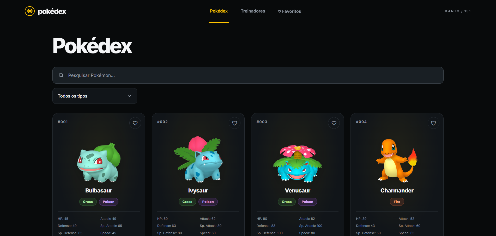
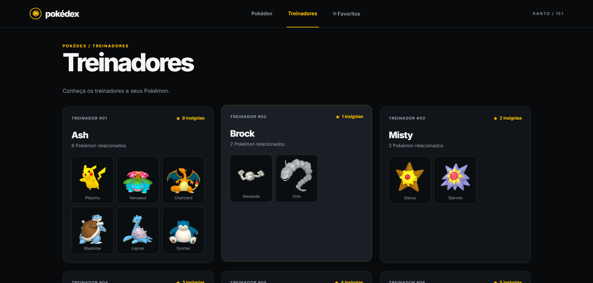
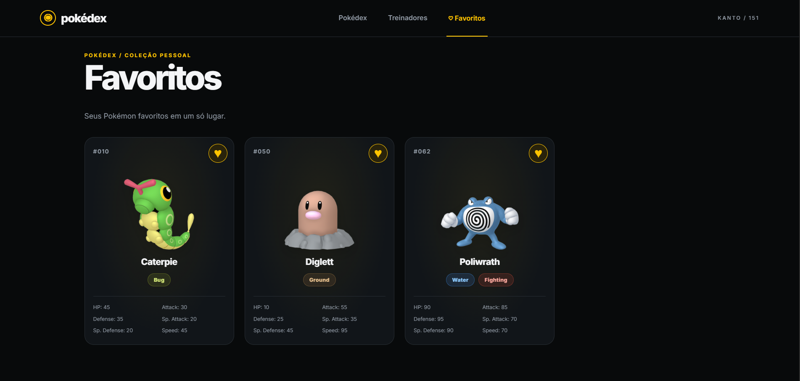
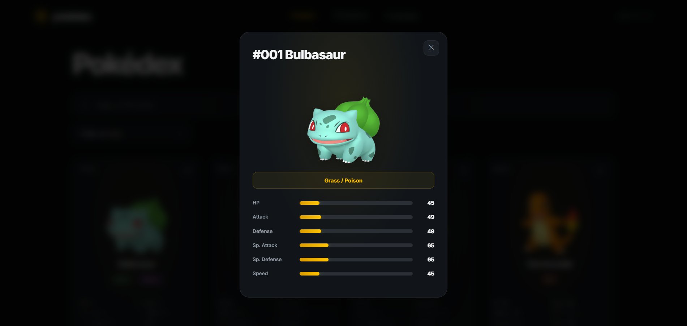

# Pokédex React

Pokédex interativa desenvolvida com **React, Vite e TypeScript** para a Atividade 03, realizada em dupla utilizando a metodologia **Pair Programming**.

A aplicação permite explorar os Pokémon, pesquisar por nome ou ID, filtrar por tipo, visualizar atributos detalhados, consultar treinadores e gerenciar uma lista de Pokémon favoritos. Os favoritos são armazenados no `localStorage`, permanecendo salvos após atualizar a página.

## Integrantes

| Nome | GitHub |
|---|---|
| Kemily Eduardo da Luz | [@kemilyy](https://github.com/kemilyy) |
| Letícia Xavier Abreu | [@xabreuleticia](https://github.com/xabreuleticia) |

## Pré-visualização

### Tela principal



### Treinadores



### Favoritos



### Detalhes de um Pokémon



## Funcionalidades

- **Listagem de Pokémon:** exibe ID, nome, imagem, tipos e os seis atributos: HP, Attack, Defense, Sp. Attack, Sp. Defense e Speed.
- **Pesquisa:** permite buscar Pokémon pelo nome ou ID, com atualização enquanto o usuário digita.
- **Filtro por tipo:** permite filtrar os Pokémon pelos tipos disponíveis nos dados, incluindo Pokémon sem tipo (`Typeless`).
- **Pesquisa e filtro combinados:** permite utilizar os dois critérios simultaneamente.
- **Detalhes do Pokémon:** apresenta os atributos em um modal com barras de progresso.
  - O modal pode ser fechado pelo botão de fechar, clicando fora dele ou pressionando `Esc`.
  - Os cards permitem abrir os detalhes por meio do mouse ou do teclado.
- **Navegação entre páginas:** permite alternar entre Pokédex, Treinadores e Favoritos pelo cabeçalho.
- **Treinadores:** apresenta os treinadores cadastrados, suas insígnias e os Pokémon relacionados a cada um.
- **Favoritos:** permite adicionar e remover Pokémon de uma lista pessoal por meio de um botão de coração.
- **Persistência dos favoritos:** utiliza `localStorage` para manter os favoritos salvos no navegador após atualizar a página.
- **Mensagens de estado vazio:** informa quando nenhum Pokémon corresponde à pesquisa ou quando a lista de favoritos está vazia.

## Tecnologias

- [React](https://react.dev/) — construção da interface por componentes.
- [Vite](https://vite.dev/) — ambiente de desenvolvimento e ferramenta de build.
- [TypeScript](https://www.typescriptlang.org/) — tipagem estática.
- CSS — estilização e responsividade da interface.
- JavaScript — lógica de filtragem, navegação e interação.
- `localStorage` — armazenamento local dos favoritos no navegador.
- JSON — armazenamento dos dados dos Pokémon e treinadores.

## Como executar

### Pré-requisitos

- [Node.js](https://nodejs.org/) instalado.
- npm, incluído na instalação do Node.js.

### Passo a passo

1. Clone o repositório:

   ```bash
   git clone https://github.com/Kemilyy/Pokedex.git
   ```

2. Entre na pasta do projeto:

   ```bash
   cd Pokedex
   ```

3. Instale as dependências:

   ```bash
   npm install
   ```

4. Inicie o servidor de desenvolvimento:

   ```bash
   npm run dev
   ```

5. Abra no navegador o endereço apresentado no terminal, normalmente `http://localhost:5173`.

### Outros comandos

| Comando | Descrição |
|---|---|
| `npm run dev` | Inicia o servidor de desenvolvimento. |
| `npm run build` | Gera a versão de produção na pasta `dist`. |
| `npm run preview` | Permite visualizar localmente a versão gerada. |
| `npm run lint` | Executa o ESLint, se configurado no projeto. |

## Dados da aplicação

Os dados utilizados pela aplicação estão no arquivo:

```text
src/data/pokedex-data.json
```

Esse arquivo é importado diretamente pelo projeto e contém os dados utilizados para exibir os Pokémon, seus atributos e tipos, além dos treinadores e suas relações com os Pokémon.

Os favoritos não são armazenados nesse JSON. Seus IDs são salvos no `localStorage` do navegador, permitindo preservar as escolhas do usuário entre atualizações da página no mesmo navegador.

## Organização do projeto

A estrutura principal do projeto está organizada por componentes:

```text
src/
├── assets/
│   └── images/
├── components/
│   ├── header/
│   ├── pokemonCard/
│   ├── pokemonList/
│   ├── pokemonDetails/
│   ├── searchBar/
│   ├── statBar/
│   ├── typeFilter/
│   ├── trainers/
│   └── favorites/
├── constants/
│   ├── pokedex.ts
│   └── stats.ts
├── data/
│   └── pokedex-data.json
├── types/
│   └── pokemon.ts
├── App.tsx
├── App.css
├── index.css
└── main.tsx
```

Cada componente possui sua responsabilidade na interface e, conforme a organização adotada, seus próprios arquivos de estilo CSS. A árvore acima apresenta a estrutura principal; os nomes e arquivos devem corresponder aos existentes no repositório.

## Decisões de arquitetura

- **Estado centralizado no `App`:** busca, tipo selecionado, Pokémon selecionado, página ativa e favoritos são gerenciados no componente raiz.
- **Lista filtrada como estado derivado:** os Pokémon exibidos são calculados a partir da busca e do tipo selecionado, sem manter uma cópia desnecessária em outro estado.
- **Seleção por ID:** o `App` armazena o ID do Pokémon selecionado e localiza o objeto correspondente nos dados.
- **Componentes reutilizáveis:** a lista, os cards, o modal e as barras de atributos são separados em componentes.
- **Comunicação por props e callbacks:** os componentes recebem dados e funções para comunicar ações ao componente responsável pelo estado.
- **Navegação controlada pelo componente raiz:** o estado `paginaAtiva` determina qual página é exibida.
- **Favoritos armazenados por ID:** os identificadores dos Pokémon favoritos são mantidos em um estado próprio, e os objetos correspondentes são obtidos dos dados originais.
- **Persistência com `localStorage`:** o `useEffect` sincroniza a lista de favoritos com o armazenamento local do navegador.

## Conceitos de React aplicados

- Componentes funcionais.
- Props e comunicação entre componentes.
- Hooks `useState` e `useEffect`.
- Estados derivados.
- Renderização de listas com `map()` e uso de `key`.
- Eventos como `onClick`, `onChange` e `onKeyDown`.
- Filtragem de dados e renderização condicional.
- Componentes controlados.
- Navegação entre páginas por estado.
- Persistência de informações no navegador com `localStorage`.

## Imagens e fontes de dados

Os dados principais são carregados do arquivo local `src/data/pokedex-data.json`.

As imagens dos Pokémon são carregadas a partir de arquivos hospedados no repositório de sprites da [PokéAPI no GitHub](https://github.com/PokeAPI/sprites). Por isso, a exibição das imagens depende de conexão com a internet.

A aplicação não precisa consultar uma API externa para obter os dados principais dos Pokémon durante a execução.

## Autores

Atividade desenvolvida em dupla com a metodologia Pair Programming, com revezamento entre piloto e navegador.

- Kemily Eduardo da Luz
- Letícia Xavier Abreu
